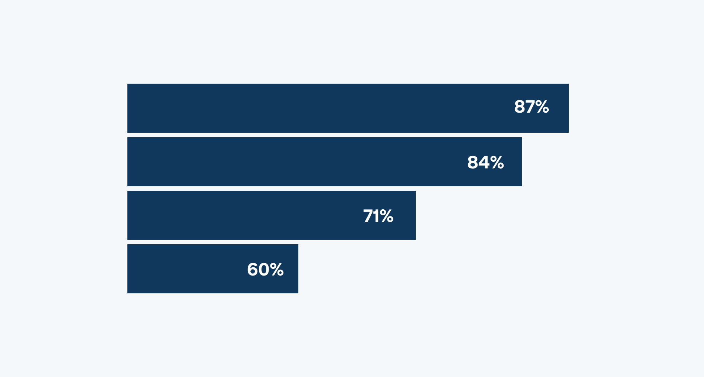
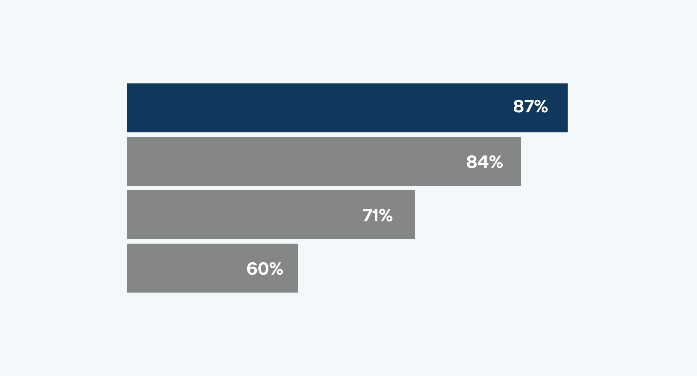
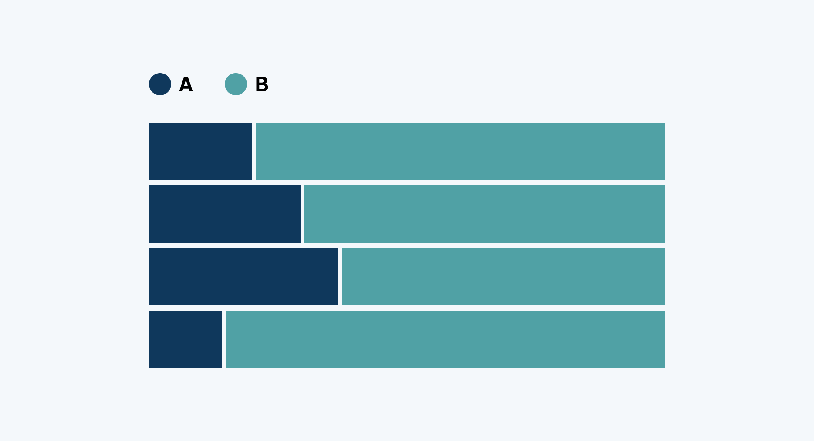
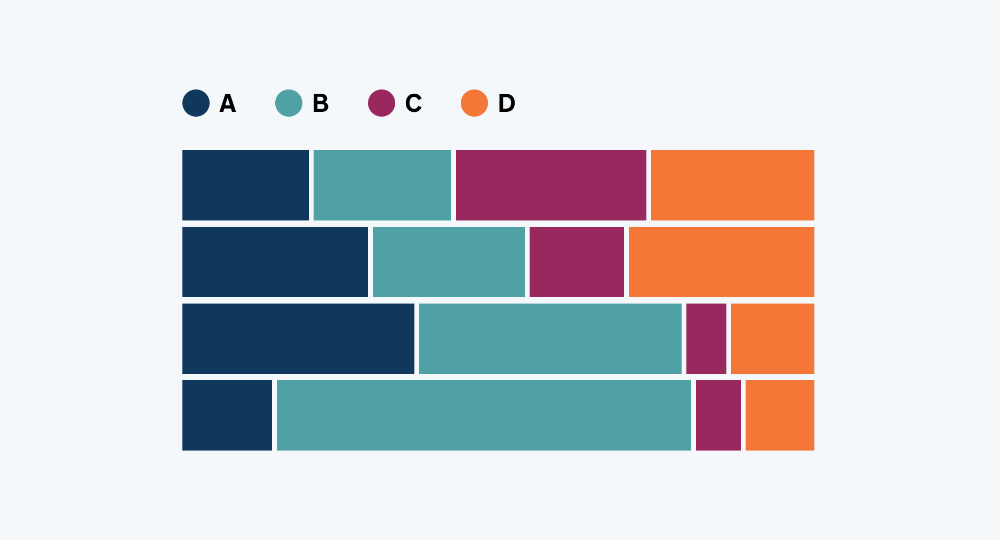
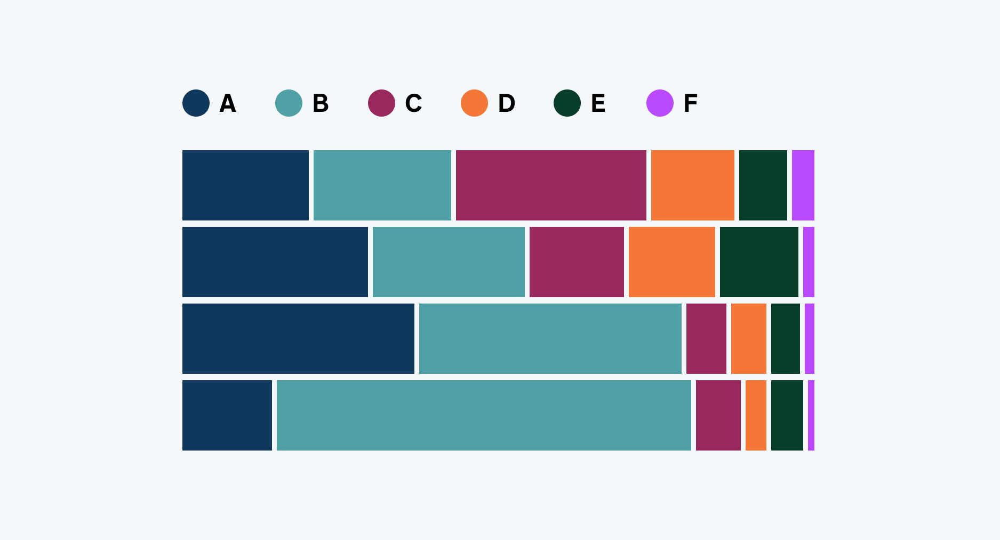
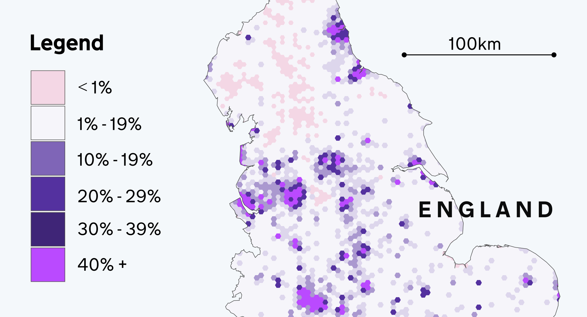

##  Using colour


Visual examples below are for illustrative purposes only.


In some visualisations, colours help differentiate between categories of data, such as in line charts or stacked bar charts. Some types of visualisations use colour to represent numerical values, such as heat maps.

The data visualisation palette has:

- colours for categorical data
- colours for sequential data

When choosing colours for your data visualisation:

- ensure sufficient contrast with the background and overlapping text
- avoid using colour as the only visual means of conveying information
- focus on applying colour that enhances the clarity of the data
- limit colours to avoid confusion

All our palettes are designed to be used with a white background.

### When to use a single colour

Certain chart types do not need colour to differentiate between categories. An example of this is a bar chart, where a single colour is used to represent the data.

#### Highlight pair (1 to 2 categories)

{% swatch { label: "Blue shade 50%", hex: "#0F385C" } %}

### Highlighting data

For charts with a single main colour, use a different colour to highlight a category or interesting data point.

#### Highlight pair (1 to 2 categories)


{% swatch { label: "Blue shade 50%", hex: "#0F385C" } %}
{% swatch { label: "Black tint 50%", hex: "#858686" } %}


## Using companion colours for categorical data

Certain charts need multiple colours to differentiate between categories of data. Examples of this are line charts with more than one series and stacked bar charts. To ensure charts on GOV.UK meet accessibility standards, you must maintain a clear visual contrast between data points. To do this, we have created 3 pairs of companion colours. When creating charts, you must always use them in order:

- use the primary pair for 1 to 2 categories
- add the secondary pair if you have 3 to 4 categories
- add the extended pair if you have 5 to 6 categories

We recommend a limit of four categories as best practice for basic data visualisations. Any more than four data points can make a chart too cluttered.

The extended pair should only be used when essential.

#### Primary pair (1 to 2 categories)


{% swatch { label: "Blue shade 50%", hex: "#0F385C" } %}
{% swatch { label: "Teal tint 25%", hex: "#50A1A5" } %}


#### Secondary pair (3 to 4 categories)


{% swatch { label: "Magenta shade 25%", hex: "#98285D" } %}



#### Extended pair (5 to 6 categories)


{% swatch { label: "Green shade 50%", hex: "#083D29" } %}



## Axes, lines and labels palette

{% set chartExtraColours = [
  { label: "Black", hex: "#0B0C0C" },
  { label: "Black tint 25%", hex: "#484949" },
  { label: "Black tint 50%", hex: "#858686" },
  { label: "Black tint 80%", hex: "#CECECE" }
] %}



### Colour palettes for sequential data

Sequential data is information that follows a logical order, such as age groups.

You should only use sequential colour palettes when absolutely necessary. The contrast ratios between neighbouring colours do not meet accessibility standards on their own, so you must use them alongside other visual indicators.

#### Formatting your data

To make your charts as accessible as possible, you must:

- keep the number of categories to a minimum (combine categories where you can)
- use a single colour scale or a small set of closely related colours
- change the lightness from tint 80% to shade 50%, rather than alternating between different colours
- progress the colours in a logical direction that users expect

Do not use too many categories. The more categories you add, the lower the contrast ratio becomes between neighbouring colours.

Avoid using colour alone to visualise data. Use a maximum of two scales in a single chart.


A map visualising urban density in England using a hex grid.


#### Blue scale



#### Magenta scale



#### Red scale



#### Green scale



#### Purple scale



#### Teal scale



#### Orange scale



#### Neutral scale


