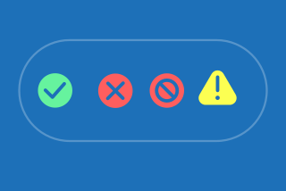

## Colour usage

Icons are generally designed to be monochromatic, using GOV.UK’s primary blue in light mode and accent blue in dark mode. They must always comply with [WCAG 2.2 accessibility standards](https://www.gov.uk/service-manual/helping-people-to-use-your-service/understanding-wcag).

However, when there is a need to enhance icons, you may use two to three of the colour shades from the colour palette. For product UI we recommend that you stick strictly to the three blue shades in our palette listed below, making the main colour our primary blue.

<!-- TODO: where should "brand palette" link to?  -->

For Social Media & Marketing additional colours from the brand palette may be used if tonally appropriate.

### App recommended palette for enhanced icons

### Light mode



### Dark mode



### Light Mode and Dark Mode pairings







**Primary blue**


**Dark mode primary blue**





**Blue shade 25%**


**Primary blue**





**Accent blue**






The top colours shows light mode colours; the bottom colours show their dark mode equivalents. Accent blue remains the same across both modes.


To improve colour contrast and meet accessibility standards, replace Primary Blue with Dark Mode Primary Blue, and replace Blue Shade 25 with Primary Blue. Continue using Accent Blue for highlights. This ensures icons remain accessible while preserving their visual hierarchy.



### Applying colour to icons





We recommend that you choose no more than three shades of blue including GOV.UK primary blue and an accent when enhancing icons in product.




For comms and social media, you may add more expression to the colour of the icons, but we recommend you keep them simple and readable at a glance.




Sometimes, you may need to introduce colour in product interfaces for feedback screens. This is used to signal key states or actions, such as success, warnings, or critical errors. Typically, these are represented by green, yellow, and red. Always refer to [GOV.UK Design System colour guidance](https://design-system.service.gov.uk/styles/colour/) to ensure you are using the correct values.




Ensure that when using the same glyph across different severity levels, you pair it with both the appropriate shape and colour. For example, use a triangle with an exclamation mark for warning states, and a circle with an appropriate glyph mark for severe alerts. This introduces two distinct visual cues, improving clarity and accessibility.



