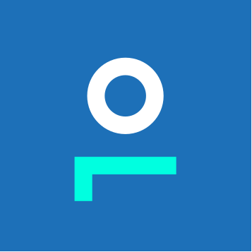
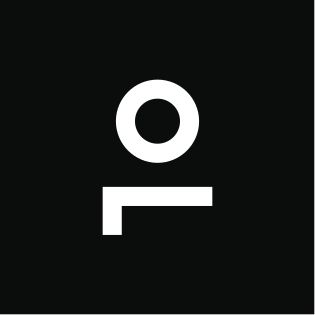
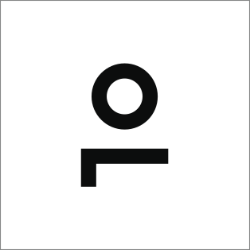
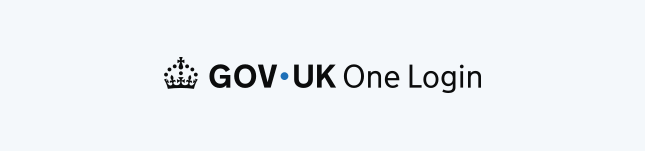

## GOV.UK One Login is blue

Our core brand colours are Primary Blue and Accent Teal. This allows GOV.UK One Login content and touchpoints to work seamlessly alongside the wider GOV.UK brand, whilst the combination of colour also allows for differentiation when needed.

Accent teal also sits alongside to add impact and help the brand feel more modern.

When using colour for web, app or social we recommend using the GOV.UK Palettes to ensure consistency across channels. You can find these palettes in this colour section.




    



    




## Using colours for the symbol

### Web

For experiences that follow the GOV.UK design system the symbol may be used in White or in Primary Blue. This ensures visual consistency across components and aligns with our established design practices.






    



    




### Print and high contrast

When using against a busy background, or in print situations where colour isn’t possible, white or black versions of the symbol can be used.






    



    




## Using colours for the wordmark

### Darker backgrounds

In most instances the wordmark will appear on darker backgrounds, such as Primary Blue. In these cases we recommend using the Accent Teal version of the symbol to ensure strong contrast, clarity, and consistent brand recognition.







### Lighter backgrounds

In some instances, the wordmark may appear on lighter backgrounds, such as tints. To ensure legibility and maintain brand recognition, we recommend using the wordmark in either Black or Primary Blue, depending on contrast and context.







### Print and high contrast

When using against a busy background, or in print situations where colour isn’t possible, white or black versions of the wordmark can be used.






    



    



