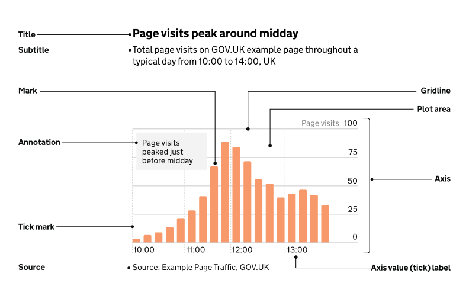
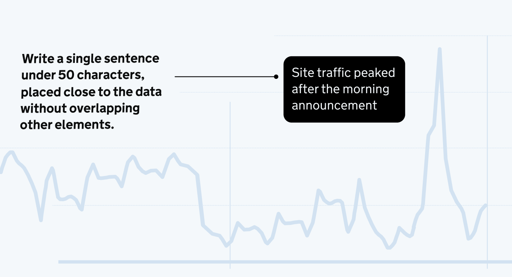
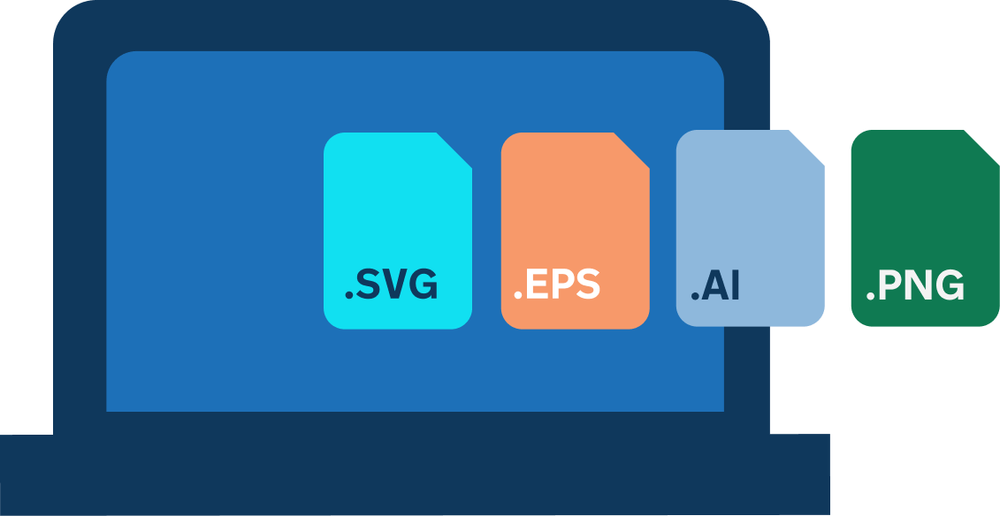

The [Colour: Charts](/colour/charts/) page shows the chart palette and how to use colour in charts, including charts in social media.

## Elements of a chart

Charts come in many forms, but most share the same anatomy. Understand the basic building blocks of a chart before creating one.

Graphical elements like the plot area, gridlines, marks and tick marks play an important role in helping the user understand and interpret the data in your chart.







### Titles

All charts need at least one title, but you should also include a subtitle.

Titles should be:

- front-loaded
- in the active voice
- in sentence case
- describing the main trend
- as concise as possible

Subtitles should include the:

- statistical measure
- geographic coverage
- time period


Indicative examples for illustrative purposes only.


### Axes

Axes show what’s being measured in a chart such as time, quantity, or categories. Clear labels help users understand the data quickly.

Use axis titles to show units, but avoid repeating details from the chart title, subtitle, or annotations.

For percentages or money, include symbols like % or £ in the axis labels. For other units, place them in the axis title or subtitle — not the labels.

Category names should be short and clear. Simplify long labels to make charts easier to read and more accessible.

When you have large numbers on an axis, use commas to separate thousands. This makes numbers easier to read. For example 121,576 is easier to read than 121576.

### Labels

All axes, series, sectors and bars used in charts should be clearly labelled so it is clear what the graph is showing.

In terms of accessibility, chart labels can be considered images of text that are essential. This means placing them within the image of a chart does not fail the legislation.

When labelling, always use horizontal text as vertical or diagonal text is hard to read. This applies to category names on bar charts and y-axis labels on line charts. If it is difficult to fit the labels into the space, try transposing the chart or changing the units.

### Annotations

Keep annotations concise. Limit them to around 50 characters (about 10 to 12 words) and a single sentence.

Place annotations as close as possible to the part of the chart they relate to.

There should be white space between your annotation text and other text or parts of your chart. Make sure your annotation text does not overlap with other chart elements.

Make sure any essential information you include in annotations is also included in the main text or footnotes.

### Sources

It’s best practice to provide source information in the following format:
[Publication, survey or other source of data] from the \[organisation]

You should give the specific data source for each chart and link directly to it if you can. For example:


Source: [Childcare and early years survey of parents](https://explore-education-statistics.service.gov.uk/find-statistics/childcare-and-early-years-survey-of-parents/2024) from the Department for Education.


### Footnotes

Footnotes play an important role in making sure data is not misused. Footnotes should only be used to provide essential contextual information for a specific chart or table. They should be as clear and concise as possible.
Using too many footnotes can interrupt the flow of the publication.

- put them in the body text of a page
- limit them to only important information
- be concise
- avoid repetition of survey names
- only refer to the data used in the chart or table.
- do not use superscript text or symbols (see Analysis Function [guidance on using symbols and shorthand](https://analysisfunction.civilservice.gov.uk/policy-store/symbols-in-tables-definitions-and-help/))

## Formatting a chart

### Always keep your chart simple

We advise to keep charts as simple as possible. When creating charts, please avoid:

- shaded backgrounds
- unnecessary borders
- boxes obscuring legends and other content
- patterns, textures and shadows
- 3D shapes
- unnecessary data markers on line charts
- thick or dark gridlines

### Consider font size and type

If creating an image of your chart, use a large enough font for all labels. Unfortunately, as images often get resized when published it is not possible to suggest a specific minimum font size. This is something you must decide when looking at each chart image.

Make sure to use a sans serif font as some people find serif fonts hard to read.


The [Typography](https://brand.design-system.service.gov.uk/typography/) page shows our fonts and provides information on how to use fonts across different channels.


### Communicating quality and uncertainty in charts

Data always has some level of uncertainty, but users often misunderstand what this means. They might assume the statistics are wrong or cannot be used. Charts and maps can also make data look more exact than it really is.

To help users understand the limitations of your data, read the Data Quality Hub’s guidance ont It explains how to format charts to show uncertainty clearly.

## Publishing a chart

### HTML or other coded formats

If the product you publish on has the functionality to build charts within the HTML code which meets the accessibility standards, use this functionality.
For example, if you publish on GOV.UK you can create horizontal bar charts in HTML.

### Scalable Vector Graphic (SVG) format

It is best practice to use the Scalable Vector Graphic (SVG) format when publishing images of charts. Unlike bitmap file types such as JPG or PNG, SVGs retain the same quality no matter what screen resolution or size they are viewed at. This means a user can zoom in and out and the image retains its quality. This adaptability makes it a more accessible format.

Changing a PNG or JPEG file into an SVG does not make it scalable, it must be done from the source file.

It is possible to save images of charts made in Microsoft programs, R and Python in the SVG format. More information can be found via Analysis Function’s [‘Making analytical publications accessible’ guidance](https://analysisfunction.civilservice.gov.uk/policy-store/making-analytical-publications-accessible/).

### Tips

Some platforms may only accept certain image sizes or file formats.
If you’re publishing on a platform or using a content management system, check for any existing recommendations.

## Useful and related links

Resources from Analysis Function:

- [Charts: a checklist](https://analysisfunction.civilservice.gov.uk/policy-store/charts-a-checklist/)
- [Data visualisation e-learning](https://analysisfunction.civilservice.gov.uk/support/communicating-analysis/introduction-to-data-visualisation-e-learning/)
- [Data visualisation: tables](https://analysisfunction.civilservice.gov.uk/policy-store/data-visualisation-tables/)
- [Releasing statistics in spreadsheets](https://analysisfunction.civilservice.gov.uk/policy-store/releasing-statistics-in-spreadsheets/)
- [Resources to use with our releasing statistics in spreadsheets guidance](https://analysisfunction.civilservice.gov.uk/policy-store/further-resources-for-releasing-statistics-in-spreadsheets/)
- [Making analytical publications accessible](https://analysisfunction.civilservice.gov.uk/policy-store/making-analytical-publications-accessible/)

Other links:

- [ONS blog posts on data visualisation](https://digitalblog.ons.gov.uk/category/dataviz/)
- [ONS guidance on data visualisation](http://style.ons.gov.uk/category/data-visualisation/)
