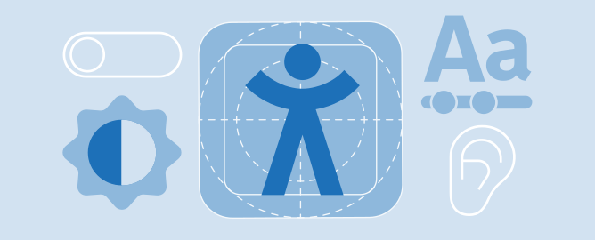
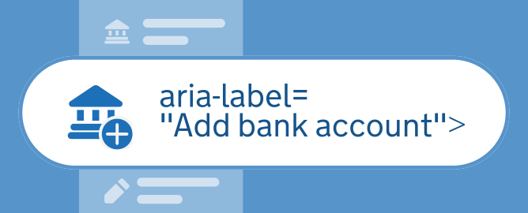
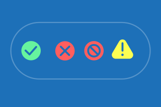





## Designing for everyone

Icons are critical navigation anchors for many users. Designing with accessibility in mind ensures our services remain usable for everyone, regardless of literacy level, cognitive ability, or vision.

Icons need to be universally understood but meanings may be interpreted differently or shift dependant upon different cultures and contexts. When designing new icons, it is important to consider whether the metaphor could be misunderstood, and use available evidence and established conventions to support icon creation and design decisions.

### Prioritise simplicity

- **Support low-literacy users:** Many users rely heavily on visual cues rather than text. Keep our icon set tight and familiar; research shows users memorise distinct shapes to navigate. A good rule of thumb is to not use a lot of different icons.

- **Ensure instant legibility:** Strip away unnecessary details. An icon must be recognisable at a glance, as complex geometry breaks down at smaller scales.

### Colour palette and contrast

All icons must comply with WCAG 2.2 accessibility standards by maintaining a minimum 3:1 contrast ratio against their background. Using transparency and opacity in iconography is generally discouraged because low-end devices often fail to render alpha channels correctly, and semi-transparent fills compromise the high contrast required for critical UI navigation elements.

### Accessible labels

When designing icon assets, clear labels bridge the gap between design systems and clean code. Designers can significantly reduce accessibility errors and empower engineering teams by establishing semantic intent directly within design files (such as Figma components) before handoff.





### Working with engineers

To partner effectively with engineers, designers have to:

- **Define the intended role:** Explicitly annotate whether an icon is decorative (reinforcing existing labels) or interactive (standalone triggers) directly within design specs or component properties.

- **Provide concise alt text:** Draft clear, human-readable labels for any standalone interactive icons (e.g., specifying "Open user profile settings" rather than a vague label like "Gear icon") so engineers have immediate, accessible copy to use for aria-label attributes.

- **Align with the design system:** Ensure icon components have built-in toggles or variants for accessibility states, making it intuitive for engineers to map them correctly to semantic HTML elements.

Never rely on the file name alone, labels should describe the action and context from the user's perspective, for example, “Add bank account” instead of just “bank”.

### Never rely on colour alone for feedback states

Colour changes must always be paired with distinct shape changes so the message is accessible to colourblind or low-vision users. When using an exclamation mark on feedback screens, strictly follow this pattern:

- Warnings: Use a yellow triangle.
- Errors or severe blocks: Use red and a glyph rather than an exclamation mark.

### Apply Badging Consistently

- Positioning: If an icon requires a secondary key message, consult the [badging guidelines](/icons/visual-system/#modifiers-and-badges) and place the badge in the bottom-right corner to maintain compositional balance.












