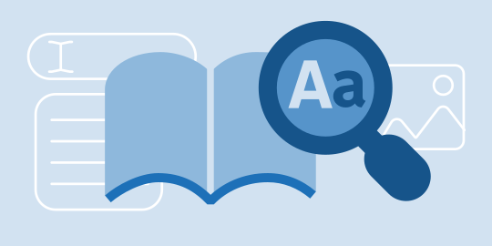
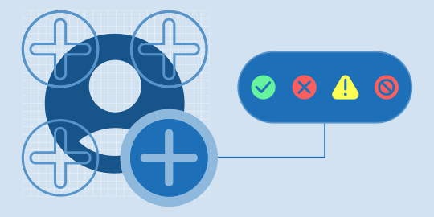
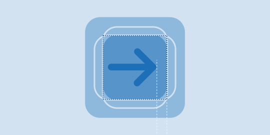
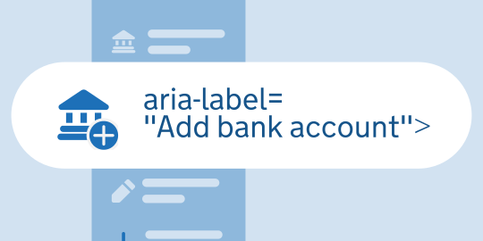
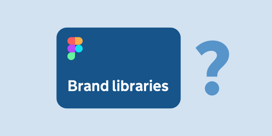
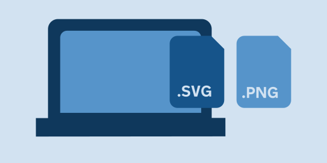




## Step by step guide

### 1. Find a metaphor

- Research: check icon libraries like [The Noun Project](https://thenounproject.com/) or [Material Design](https://m3.material.io/styles/icons/overview) to find common symbols that clearly represent your idea.
- Find the simplest metaphor: ensure the icon can be read at a single glance, and strip away any unnecessary details that compromise its readability.
- Acknowledge the constraints: Apple's SF Symbols are currently the most constrained library to align with the GOV.UK brand. Select your metaphors from SF Symbols first, and then find the android version to ensure baseline compatibility.

### 2. Apply construction principles

- Draw your icon on a 24x24 px canvas, using the provided grid shown in the Visual System section.
- Build the outlined version first, as it is much easier to convert an outline into a filled shape later than the other way around.
- Finalise the geometry by locking down the outer silhouette first, then adding interior details and balancing the roundness and sharpness of the shapes.

### 3. Check for consistency and detail

- Find other existing GOV.UK icons that are similar to the icon you are trying to build and place them next to your icon to see if they feel consistent and from the same GOV.UK brand icon family.
- Make sure that inside details are sharp and of the same size as other icons.
- Check that the mass of the icons feels appropriate and balanced.

### 4. Adding badges

- Determine if you need a secondary message by reviewing the badging guidelines.
- Position the badge for compositional balance, using the bottom-right corner as your default location.
- Match the badge shape and colour to the severity level on feedback screens:
  - Warnings: Use a yellow triangle and an exclamation mark.
  - Errors or severe blocks: Use a red circle with a cross or block icon.

### 5. Centering & flattening

- Check the icon alignment: align optically, not just mathematically. Software alignment tools work for symmetrical shapes, but directional icons (like arrows or triangles) require manual shifting to look optically balanced.
- Use a bounding box: centre inside a bounding box and flatten strokes to prevent distortion when scaling.

### 6. Provide accessible labels

Always check that icons follow our naming convention, provide clear and concise screen reader labels (or hide decorative icons), and ensure you hand off the exact text for those labels to engineering.

### 7. Review by Brand Team

Submit your icon to the GOV.UK Brand Team for review to maintain brand consistency and ensure it aligns with our design principles. The team can also help identify whether a suitable icon already exists, reducing duplication and promoting reuse across the GOV.UK icon library. [Get in touch](mailto:govuk-brand-team@dsit.gov.uk) with the team to initiate the process; once approved, they will add your asset to the corresponding library.

### 8. Handoff to engineers

Before delivering icons to engineers, it’s really important that you optimise them, following the next process rigorously:

- Minimise vertices
- Correct fill errors
- Change the fill rule to Non-Zero Winding Rule in the attributes panel.
- Optimise the vector
- Check code hygiene
- Apply the standard naming convention: gov_uk\[team]\_ic[type of asset]\_\[description]\_\[tags]\_\[style]



