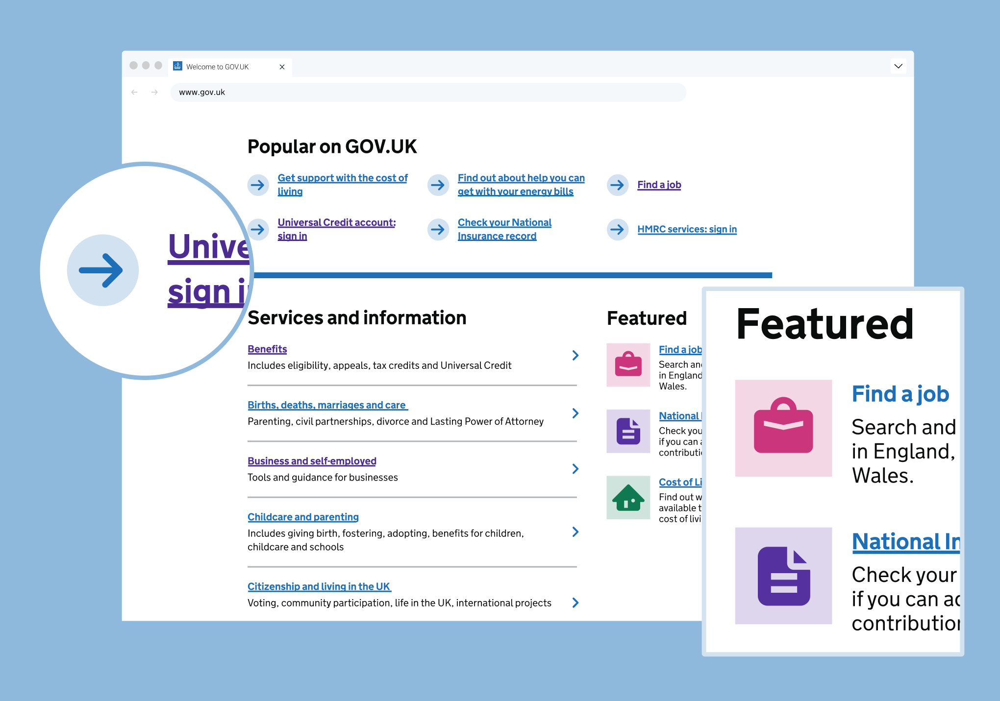
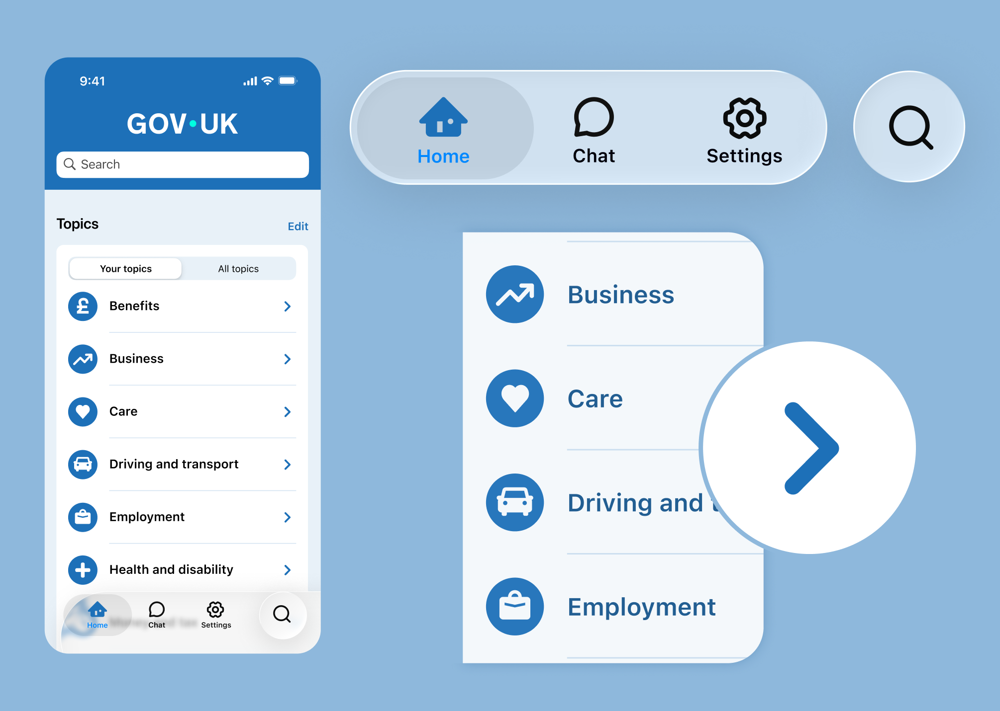
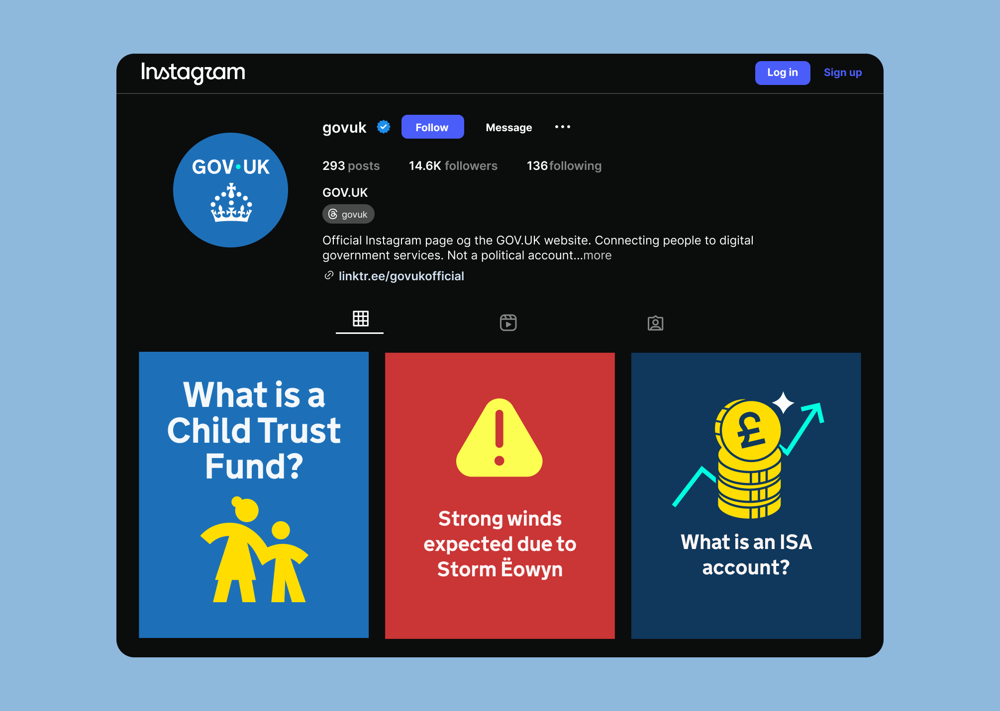

These examples show how GOV.UK icons are used across GOV.UK web, app, and social media channels.


Below are indicative examples for illustrative purposes only


## Across our channels

### Web





### App





### Socials




