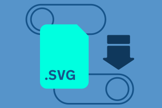
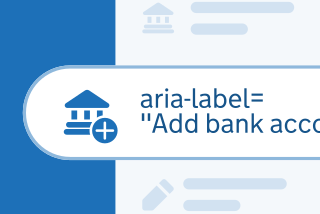
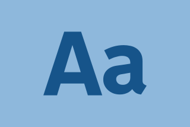
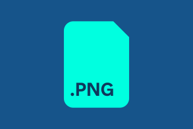

Assets require specific technical handling before they are ready for production. To ensure maximum performance and code efficiency, please follow these guidelines.

Depending on the use case, you may need to export assets as PNGs or SVGs directly from Figma. Both formats require post-export optimisation to avoid negative impacts on the app’s performance.

## Preparing assets for delivery

We recommend using a single SVG whenever possible and following these 7 steps in order:





### 1. Minimise vertices

Use the pen tool in Illustrator or another vector and remove as many anchor points as possible, without compromising the desired shape.









### 2. Flatten strokes and correct fill errors

Make sure everything is flattened, and in one single vector. Change the fill rule to Non-Zero Winding Rule in the attributes panel of Ai (Adobe Illustrator) to avoid the even/odd error. This is the most reliable way to ensure shapes render correctly in all browsers and apps.









### 3. Optimise the vector

Run the file through an optimiser like [SVGOMG](https://jakearchibald.github.io/svgomg/). Adjust the settings to remove redundant data while ensuring the shapes do not become corrupted.









### 4. Check code hygiene

Open your SVG in a text editor. Ensure the code is clean and using as few characters as possible.




<pre><code>&lt;svg
 width="55"
 height="55"
 viewBox="0 0"</code></pre>




### 5. Provide accessible labels

When handing assets to engineering, always provide: the semantic role (decorative or interactive), the exact screen label to use for the aria-label, and the user-facing context or action the icon represents. Never rely on the file name, labels should describe the action and context from the user's perspective, for example, “Add bank account”.









### 6. Align to naming convention

When delivering assets to engineering, using this strict naming convention ensures seamless integration into the codebase, allowing developers to instantly identify, automate, and implement icons without friction.

gov\_uk\[team\]\_ic<wbr>\[type of asset\]\_\[description\]<wbr>\_\[tags\]\_\[style\]









### 7. PNGs

If you require a PNG, you may need to export at various sizes. Always make sure you have run the exported files through a standard image compressor.








