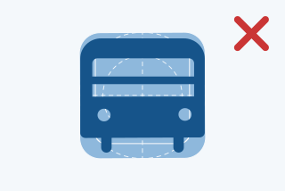

Icons help communicate complex concepts, making GOV.UK content clearer, more accessible and relevant for everyone. To maintain visual consistency, avoid the following:

## Avoid these mistakes




### Don’t use outline icons on lists

Avoid using outline-style icons for static list items or informational labels. GOV.UK’s default icons are filled with the exception of those places where icons become interactive buttons that change states (like hover or click).








### Don’t use filled icons in the navigation bar

Filled icons carry too much visual weight, making inactive navigation items look selected when they are actually resting.








### Don’t forget margins and visual alignment

Always draw icons on the provided grid, leaving consistent margins on all sides. These margins create the optical space needed to balance differences in volume and mass between different icon shapes.








### Don’t round interior details

To maintain a visual stylistic connection with the GDS Transport typeface and GOV.UK’s design heritage, interior details and corners remain sharp.








### Don’t add excessive details

When scaling an icon up into an illustration, keep the main glyph consistent and avoid excessive decoration. Ornaments can clutter the design and reduce readability.








### Don’t use transparency in icons

Partially transparent pixels or translucent areas render poorly on low-end devices and clash unpredictably with varying backgrounds, such as custom user themes or dark modes. Keep all icon vectors fully opaque to ensure crisp, clean rendering in every environment.






