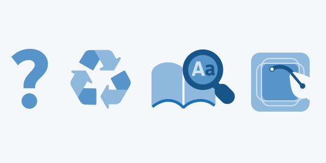
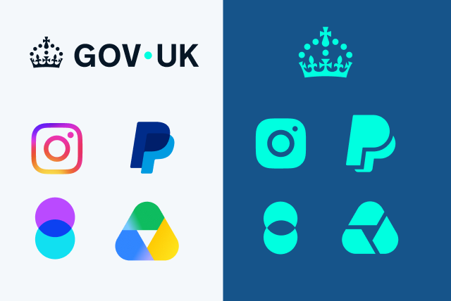
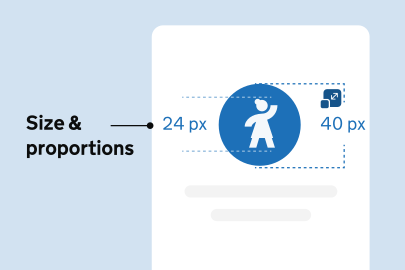

Icons are functional assets, not just decorations. Every asset we add to a digital product increases load times, risks performance lag, and can create friction for our users. We must be fiercely mindful of every single icon we introduce.

At the same time, icons are vital accessibility tools. Low-literacy users rely heavily on visual symbols to navigate our apps, memorizing them to find their way. Keeping our metaphors consistent, minimizing our visual set, and prioritizing reuse isn't just great for app health, it is an inherent act of kindness toward our users.

## Our Policy: Avoid. Reuse. Research. Make





**Avoid:** Is this icon actually necessary? If a clear text label can do the job alone, and there is no contextual reason that will require it to have an icon, skip it.

**Reuse:** If an icon is necessary, audit what we already have. Icons are polysemic depending on the context. Try to adapt an existing icon to fit your new use case and always check the GOV.UK library first.

**Research:** If a new icon is required, research the metaphor thoroughly. You need to ensure the visual shorthand is intuitive, universally understood, and culturally inclusive.

**Make:** Only when the first three steps are exhausted should you create a new icon strictly aligning with GOV.UK guidelines.






### Remember

All new icons should be checked by the GOV.UK Brand team and added to the library.









## Native guidance

### The Long-Term Vision (Our "North Star")

Our ultimate goal is to have a unified, custom-branded GOV.UK icon set deployed across all channels (Web, Android, and iOS) to ensure a seamless, branded user experience.

To keep the ecosystem up to date:

- Web, Social & Comms: The GOV.UK custom icon set should be maintained as the source of truth across web, social and communications channels. Any new icons should be reflected across these platforms to ensure consistency.

- Mobile (Android & iOS): Native mobile apps can continue to use native navigation patterns and native icon libraries (Material Design for Android, SF Symbols for iOS). Where GOV.UK-specific icons are used, they should be reviewed and updated alongside the core GOV.UK icon set to maintain a consistent branded experience.

### The core rule: metaphorical consistency

While the visual style between web, social and comms and mobile will differ slightly during the transition, the metaphor must be identical across all surfaces.

**Example:** If the icon for "Work/Jobs" is a briefcase on the web, it must be a briefcase on iOS and Android. We cannot have a briefcase on web and a wrench or building on mobile.

To ensure this metaphorical consistency works across the board, all icon design choices must start by auditing SF Symbols (iOS) as it is more restricted and limited than Material Design, it represents our lowest common denominator. If a metaphor doesn’t exist or work in SF Symbols, we cannot use it on Web or Android.

## The interim strategy





### Type of icons

Most icons are polysemic and can be used to represent more than one message. For example, a pencil may mean 'draw,' but it also generally represents 'edit' or 'creation.' However, it is crucial that we maintain metaphors and follow general UI practices to help our users fulfil their tasks. At GOV.UK, you may hear us mention functional icons, contextual icons, and branded icons.





### Functional icons

Functional icons are designed to aid function and navigation across digital services. This set includes a lot of the defaults that any UI or system would likely require, serving as universal visual shortcuts for immediate user actions like searching, downloading, or deleting.









### Contextual icons

Contextual icons provide visual support and give context to content, helping to contextualise information in its specific setting. They are likely to be used on the web, in an app, or sitting alongside a caption or copy, as well as within a more expressive or creative setting such as a social post.









### Branded icons

Certain glyphs are reserved for specific features or meanings and should not be repurposed elsewhere. These include feature identifiers, and logos. For example, the concentric circles are exclusively used to represent AI Chat, while the GOV.UK crown is reserved for government services.

When these identifiers appear alongside other icons, the line weight, proportions, or overall visual mass may have to be adjusted to the set, while preserving the recognisable shape and meaning of the original identifier.









## Enhancing icons

Adding decorative elements to icons can be a valuable strategy if done consistently. It also helps create a unified communication system that bridges the gap between icons and full illustrations. We showcase these icons in two ways: using a background shape to assist with wayfinding, or applying a maximum of three colours from the [blue palette](/colour/web/#blues) (Primary Blue, Blue Shade 25, and Accent Blue).

Enhanced icons help users build familiarity with a feature, to improve navigation, or to support functional storytelling in marketing and social media where a full illustration would tonally feel out of place.









### Background shapes

We recommend using icons with no added ornaments for simplicity and to reduce cognitive load. However, you may add a background circle if you want to highlight a specific icon. Please always start with a 24x24px icon inside a 40x40px container. If larger sizes are needed, follow these proportions.









### Storytelling with multiple icons

When pairing icons to convey a functional story within the app, limit the combination to a maximum of two, keeping them upright and restricted to a single key colour to ensure optimal readability and wayfinding. However, for communications and social media, you can introduce more visual expression by rotating the icons to match the tone of the content, provided the overall composition remains simple and instantly recognisable.









### Lists

To prevent icon fatigue, try to avoid repeating the same contextual icon across a list. Consider the overall context and collective communication of the set, it is sometimes helpful to focus on the action if the first icon establishes the context. Reducing icon repetition in lists prevents visual clutter while simultaneously streamlining the screen reader experience. Eliminating redundant graphics and ensuring that assistive technologies do not pollute the auditory stream with unnecessary alt texts, helps user comprehension.









### Icons inside illustrations

When incorporating icons into illustrations, review the core [illustration style guidelines](/illustration/) and adapt the icon’s scale and stroke ends to align with that visual language. For example, an icon’s ends may be changed from rounded to flat to harmoniously balance the sharp and rounded elements of the surrounding artwork.









### Icons to illustrations

When evolving an icon into an illustration, keep the core silhouette or primary shape consistent. You can introduce subtle details, adjust proportions, explore perspective, or refine edges, but the overall form should remain recognisable. Maintaining this consistency ensures the illustration still clearly relates to the original icon.








