Our visual grammar is designed to be a direct embodiment of our core principles. For our iconography to feel functional, approachable, and 'humbly unique,' we must translate these values into a consistent visual language. To maintain this balance, please adhere strictly to the to the following rules.

## Icon rules





### Reference the dot

Start with a circle and switch to other basic shapes only to maintain legibility. Reference ‘the dot’ through rounded embellishments, like a bell’s crown and ringer, provided they enhance clarity without adding clutter.




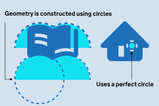




### Ensure mass cohesion

Mass cohesion is key in our icon system. We have a grid to help you design icons, but this is not an absolute mathematical law. Icons must never be designed in isolation; blindly stretching shapes to fill the grid boundaries makes wider symbols (like the metro) look overwhelmingly massive next to taller icons (like the bus). You must always prioritise optical balance over mechanical alignment so the entire set shares the same perceived visual weight.









### Rounded exterior

On our standard 24x24px canvas, icons use a strict two-tier corner radius system: 4px for large exterior corners and 1px for small edges. Interior corners of outlined icons must remain sharp unless rounding them is absolutely necessary to improve the readability of the object. If so, always nest the inner curve into the outer curve.




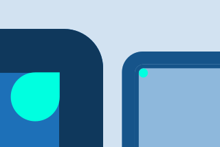




### Soft vs. sharp

We maintain an approachable aesthetic by keeping the exterior joints and ends rounded. This is balanced with sharp interior details creating a balanced visual that builds on the design tradition of GOV.UK. Outlined icons always have lines of 2px at the 24x24 core size. Interior details may need visual adjustments, specially for filled icons. We recommend a line weight of 1.5px for interior details and 2.5px for elipses and/or other small basic shapes.




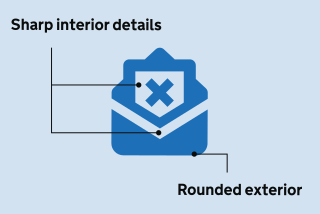




### Filled Icons as Default

Filled icons are our default. Although we design both variations together to allow for toggle options, the general guidance for GOV,UK’s icons is filled.









## Sizes

Below are the primary icon sizes used across web and mobile apps. Every icon is designed on a core 24x24px canvas and should be scaled proportionally to the dimensions listed below. Social media platforms may adapt these to intermediate or larger sizes as needed. Whichever size you use, ensure that outlined icons maintain consistent stroke weights across the same screen to preserve visual harmony.

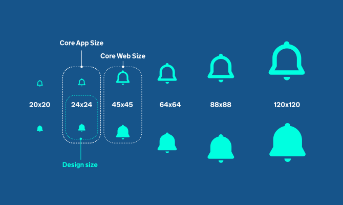
The six sizes are 20x20, 24x24, 45x45, 64x64, 88x88 and 120x120 pixels. The 24x24 size is labelled as both the core app size and the design size, and the 45x45 size as the core web size.





### The Grid

We always design at 24x24px. Try to align structural details to core focus areas and snap your vectors to the pixel grid to ensure crisp rendering on lower-resolution devices. The grid is meant to be a guide but ultimately, mathematical precision should never compromise visual balance, so always rely on optical adjustments to make the final design look right.




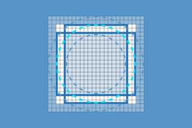




### Icons at large sizes

At large scales in social media, web, and marketing, you can add extra details to make the icons more engaging. Conversely, when scaling down to micro-sizes like 20px, 16px, or 12px, reduce or eliminate details to maintain clarity. In App please try to stay within the confines of the core app sizes. When adding elements, preserve the core silhouette and ensure any adjustments remain visually consistent with the details in the original design.




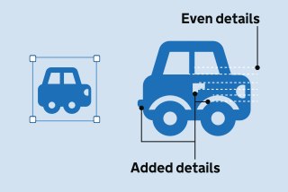




## Filled vs Outlined Styles

Filled icons are our default. Both styles are designed together to support toggling, but optimisation should focus on the filled icon set first.





### Optical Adjustments

To balance the optical weight of a pair of icons you will need to consider them together so they feel like the same icon. These require optical adjustments where the stroke and weight of certain details may need to be altered.




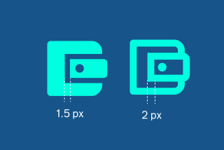




### Toggle states

To ensure a seamless transition when swapping between states, the outer silhouettes must match perfectly. Interior details may differ, as we prioritise the overall appearance of the filled icon and may make optical adjustments to individual details where needed.




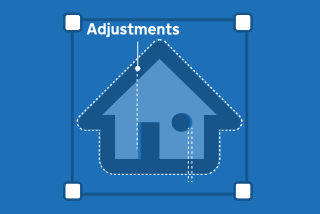




### Monoline Icons

For inherently line-based objects, forcing an outline onto an already thin shape increases cognitive load. In these edge cases, we use a 2.5px line weight for the outlined version and an extra 0.5px to the filled version to boost its weight so it matches the visual mass of other solid icons. Additionally, because these icons lack internal negative space to feature our signature sharp interiors, we recommend balancing the sharp and rounded details of the exterior silhouette.




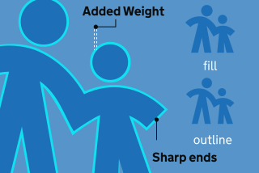




## Modifiers and badges

Modifiers and badges are used to extend the meaning of a core icon by indicating an action, status, or secondary piece of information. Modifiers communicate actions such as add, remove, edit, or block. Badges communicate a temporary state, such as a notification and are typically positioned in the top-right corner of the icon.

Both modifiers and badges are contained within a circular shape inspired by the GOV.UK dot. Modifiers are drawn within a 10 × 10px container, while notification badges use a smaller 6 × 6px container. The internal glyph of a modifier uses a consistent 1px stroke weight. Badges include a 1px outer stroke that masks any underlying iconography, ensuring they remain clear and distinguishable when overlaid on an icon. Notification badges containing numbers should be sized appropriately to maintain legibility while remaining visually consistent with the wider icon set.





### Positioning of modifier

By default, modifiers are positioned in the bottom-right corner of the icon space, flush with the outer bounding box. However, alternative placement and size adjustments may be required for specific icons to ensure proper optical balance and visual weight. There should be no difference of the badge in filled/outlined icons.




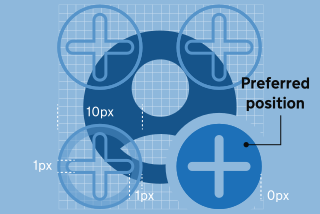




### Slashes

Use slashed icons to represent "off" or disabled states, such as muted audio or hidden passwords. Use fill patterns to indicate active selections or saved states.

Position the 45° slash centrally across the icon, adjusting its placement only when needed to maintain legibility. Anchor the slash to the icon on one side and leave a small knockout gap on the other for clarity.

For filled states, increase the slash weight by 0.5px to match the visual weight of the mono line icons.




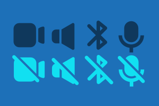



