The GOV.UK One Login logo system represents our visual identity at the very highest level and is vitally important to our brand. This guidance will give you the confidence and knowledge you need to use it correctly.

## Logo system elements

The GOV.UK One Login logo system is comprised of three elements; the symbol, crown and wordmark.





### Symbol

The symbol is our shorthand identifier and should be used as the lead asset in places such as on interactive components within the GOV.UK web header




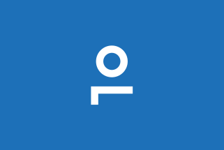




### Crown

Where the crown is used, it is either as a lock-up or across channels as a supporting element.









### Wordmark

The wordmark is our longform identifier, used as a lock-up alongside the GOV.UK wordmark on web and in print.









## Brand hierarchy

GOV.UK One Login is an ingredient that exists within the GOV.UK master brand. It is not standalone and must always be presented in conjunction with the primary GOV.UK identity. This ensures consistency, trust, and clarity for users interacting with government services.

1. Master brand: GOV.UK
2. Ingredient brand: GOV.UK One Login

## Colour

When using colour for web, app or social we recommend using the GOV.UK palettes to ensure consistency across channels. Please refer to the colour section of the GOV.UK brand guidelines for more information.

## Symbol

Our symbol has been crafted to work both as a standalone mark, and as a component that sits coherently alongside the wider GOV.UK brand, such as within the web header.

Using the ‘O’ and ‘L’ from the One Login name to form a ‘head and shoulders’ user icon creates a distinctive mark that still feels familiar and intuitive to users.

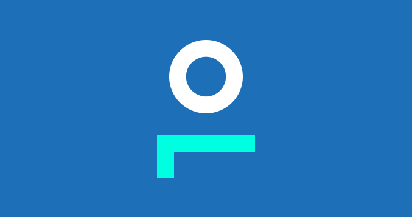





### Minimum sizing

To ensure accessibility and legibility the symbol must not be scaled below 15px.

Reducing the symbol too much can lead to loss of detail, making it difficult to recognise.




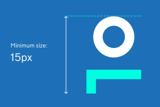




### Clear space around symbol

Maintaining clear space around the symbol is essential to ensure its visibility, impact, and legibility. By respecting clear space guidelines, we preserve the symbols integrity and ensure it remains a strong and recognisable brand asset.

The clear space area is defined by the half an ‘O’ or half circle size, as depicted in the diagram to the right.




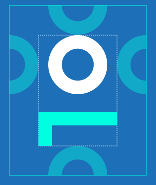




## Wordmark suite

For use and flexibility across channels, there are multiple versions of the GOV.UK One Login IS it clear enough to a user that they are in OL logo section here and not GOV.UK logo section (with exception of highlighted blue underscore in top nav?).





### Wordmark with crown

For use on web and print only.









### Wordmark with crown as a supporting element

For use across channels, where the crown can be used as a supporting element.









## Brand hierarchy text lock-up

The brand hierarchy text lock-up is a fixed layout that combines GOV.UK brand elements – the crown or wordmark – with text. In most cases, the text names an ingredient brand, as show here (i.e. GOV.UK One Login) channel or service. These lock-ups help show the relationship between GOV.UK and the service, channel or department they support.

**We have five versions:**

1. Horizontal
2. Horizontal with crown
3. Stacked (web)
4. Stacked with crown
5. Stacked (apps)

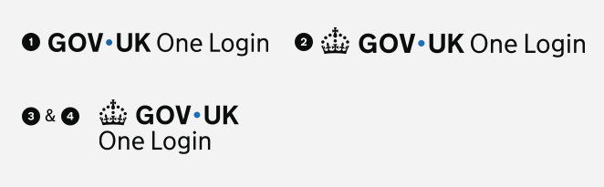


For number 5 (stacked apps) scroll down to view the lock up on the mobile screen


## Spacing for the wordmark and text lock-up

To keep the brand consistent, use each version exactly as shown – don’t resize, reposition or remove any part.

The diagrams show how to space the wordmark and text in a lock-up. Use the width of the dot in the GOV.UK wordmark to set the spacing.

## Wordmark within the GOV.UK header

The GOV.UK One Login wordmark should only be used within the header space when the user is within the GOV.UK One Login service, such as on the user dashboard.

For other journeys where a user may interact with GOV.UK One Login, this should be signposted as a standalone wordmark within the content itself.

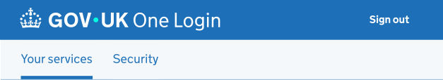


Desktop header: GOV.UK One Login user dashboard


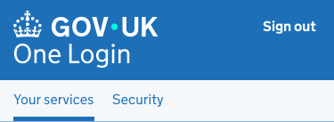


Mobile header


## Using the crown as a supporting element

A lock-up system where we can position the crown in close proximity to the GOV.UK One Login wordmark to offer greater flexibility when designing for a range of channels.

### Lock up system


Example: mobile splash screen. Indicative examples for illustrative purposes only.


## Clear space around wordmark

Maintaining clear space around the logo is essential to ensure its visibility, impact, and legibility. By respecting clear space guidelines, we preserve the logo’s integrity and ensure it remains a strong and recognisable brand asset.

The clear space area is defined by the dot size within our wordmark.

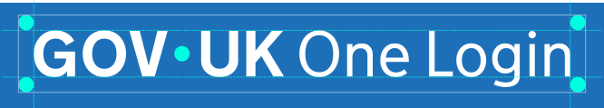

## Minimum sizing

Logo elements must not be scaled below the minimum size of 115px. This will ensure accessibility and legibility of the logo. Reducing the logo too much can lead to a loss of detail, making it difficult to read or recognise.

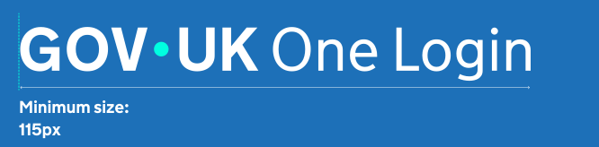

## Incorrect usage

To maintain consistency across channels the logo elements should never be changed or altered.



Do not use the One Login identity in isolation. It must always appear as alongside the GOV.UK master brand and be clearly presented as a supporting element. The name One Login must also never be written as one word, i.e., OneLogin.


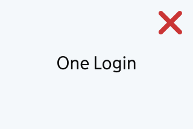



Do not alter colour balance within the symbol


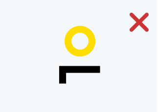



Do not distort, stretch or skew the symbol


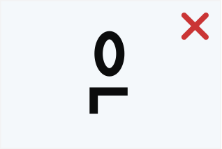



Do not apply drop shadows or effects to the symbol


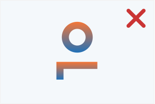



Do not use the symbol on overly busy or low-contrast backgrounds


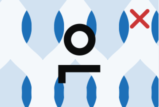



Do not flip, mirror, or rotate the symbol


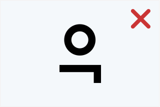



Do not alter colour balance within the wordmark






Do not distort, stretch or skew the wordmark






Do not apply drop shadows or effects to the wordmark






Do not use the wordmark on overly busy or low-contrast backgrounds






Do not flip, mirror, or rotate the wordmark






