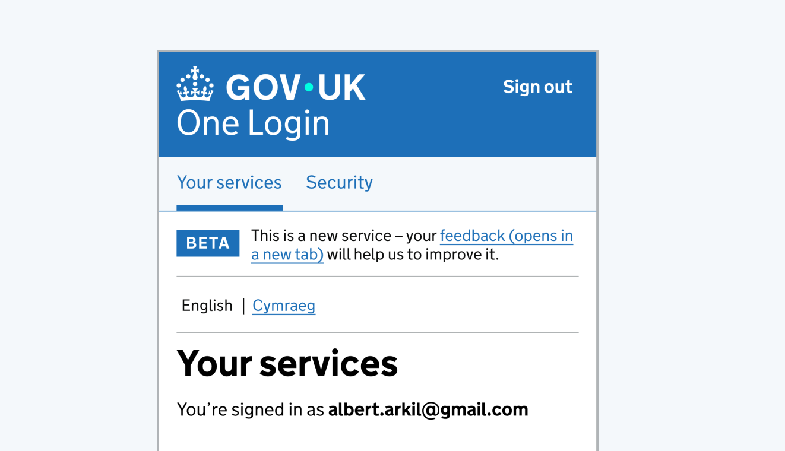

The GOV.UK One Login service header gives users an easy, consistent route from your service to their GOV.UK One Login and a way to sign out.

The header contains two distinct navigation menus - one for GOV.UK One Login links and another for internal service navigation, which uses the Design System service navigation component.

Indicative examples for illustrative purposes only.

## Service header example: Desktop

‘GOV.UK One Login’ is shown in its default state. ‘Sign out’ is shown in its hover state, with an underline.

## Service header example: Mobile

On smaller screens both menus collapse into a mobile-friendly format and can be shown or hidden as needed. Adapt the internal service navigation to include content specific to your service.

## Home header example: Desktop

The home header gives users direct access to their GOV.UK One Login home space and associated account services.

## Home header example: Mobile

